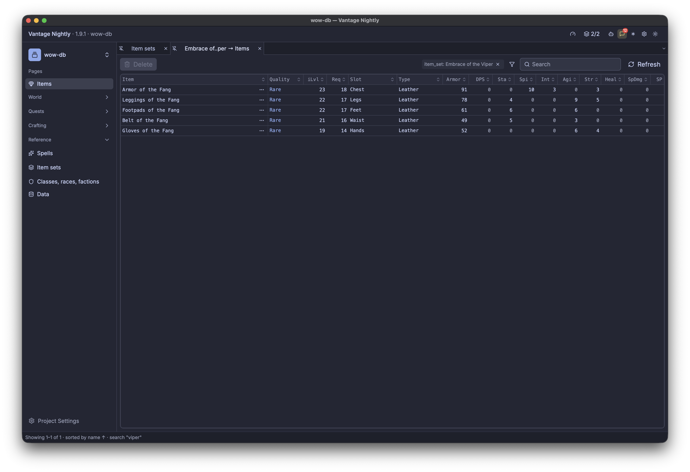

# wow-plan

Game data and leveling guides for World of Warcraft: Forever.

- **Reference data.** Every item, zone, quest, recipe, NPC and spell for a given client build,
  cleaned and indexed. Rebuilt from public sources whenever a new build ships. Read-only.
- **Guides (planned).** Personal leveling guides for one or two characters, built with AI help,
  shared through short links and cloned to modify. Stored in MongoDB and pointing at the
  reference data by Blizzard ID.
- **API and MCP (planned).** Read-only access to the reference data and access to guides, for
  the wow-plan.com web client and for AI agents.



*The Vantage admin, opened on the items of one item set. Every stat is a sortable column;
selecting an item shows it as an in-game style tooltip.*

## Layout

| Path | What |
|---|---|
| `datasource/` `table/` `page/` `menu/` `action/` `view/` | the Vantage admin app: browse and check the data |
| `pipeline/` | fetch and import: downloads a build's tables, runs dbt, publishes to Postgres |
| `dbt/` | dbt project that turns downloaded tables into the published data set ([README](dbt/README.md)) |
| `docs/` | designs |
| `seeds/` | our own data for facts no source publishes ([README](seeds/README.md)) |
| `mongo/` | guides in MongoDB: collection schema and sample plans ([README](mongo/README.md)) |
| `api/wowplan.yaml` | the API the web app and MCP agents use: plans by id, edits only to plans the session unlocked with the edit key (`unlock_plan`; the rule is in `datasource/plans.yaml`) |
| `web/wowplan/` | the wow-plan.com React app (built by Vantage's web dev container) |
| `tests/` | `api_actions.mjs`: checks the API's actions over the WebSocket (`node tests/api_actions.mjs <api url>`) |
| `agents/` | notes for AI agents working on this repo (`BRIEF.md`) |
| `scripts/` | `session_stats.py`: measures an agent's build session for the web app's About screen |
| `composer.yaml` | local services Vantage starts |
| `refs/` | downloads: the opendata clone and wago.tools exports. Not committed |
| `data/` | local database files. Not committed |

## Sources

- [wago.tools](https://wago.tools): the game client's data tables (DB2) per build, exported as CSV.
- [wowlayerup-forever/opendata](https://github.com/wowlayerup-forever/opendata) (CC BY 4.0):
  quests, NPCs and objects from players' game caches, later loot, vendors and spawns.

Nothing here is scraped from Wowhead or similar sites. World of Warcraft and related names are
trademarks of Blizzard Entertainment; this is a fan project, not affiliated with Blizzard.

## Building the data

Open the project in Vantage, start the services, then on the **Data** page press **Fetch build**
and **Import build** (or run the **Setup guide**). Both run in the `pipeline` container, so
nothing needs installing. From a terminal:

```bash
python3 pipeline/pipeline.py fetch      # newest Forever build's tables from wago.tools
python3 pipeline/pipeline.py import     # dbt build, then publish to Postgres schema wow
```

`import` on the host needs `.venv` (`python3 -m venv .venv && .venv/bin/pip install dbt-duckdb`).
Details: [dbt/README.md](dbt/README.md).

## Web app

`web/wowplan/` is wow-plan.com: the intro page (`/`) and a plan by its link (`/p/<id>`).

A small "About this demo" link at the foot of every page opens `/about`
(`src/components/About.tsx`): what the site is, that an AI agent built it in Vantage UI, how it
was built in measured numbers, and what Vantage replaced compared with building it by hand. It
never opens by itself. The numbers live in `src/about.ts`, whose header says how to refresh them
(`python3 -I scripts/session_stats.py <session log>` and `git ls-files` counts); don't edit them
by hand.

Analytics (`src/analytics.ts`) sends to wow-plan.com's own GA4 stream. The page reads its
measurement ID at run time from `/config/settings.json` (`{"gaMeasurementId": "G-…"}`), which
Cloud Run mounts into the web root from the `wow-plan-web-settings` secret
(vantage-terraform, `modules/wow-plan-gcp`); change it there and `tofu apply`, no rebuild. It
links sessions across vantage-ui.com and wow-plan.com and sets `content_group: demo-wow`. The tag
loads only when that file names an ID and the page is on `wow-plan.com`, `www.wow-plan.com` or
`wow.demo.vantage-ui.com`; elsewhere `track()` logs `[ga] name params` to the console and sends
nothing. Page views come from GA's
enhanced measurement (the router uses the History API). Events: `about_open` (the footer link),
`outbound_click` (any link to another host), and `demo_action` with `create_plan`,
`unlock_plan`, `complete_goal` or `edit_notes`, each sent when the server accepts it.

```bash
cd web/wowplan && npm test && npm run typecheck
```
